# Will's Body

A mobile-first, offline-capable gym logging app (Progressive Web App) built with plain HTML, CSS and JavaScript: no framework, no build step, no backend. It plans each exercise's next session from your history, keeps the rest timer in reach, and stores everything privately on the device.

**Live app:** https://stocks84.github.io/wills-body

<p>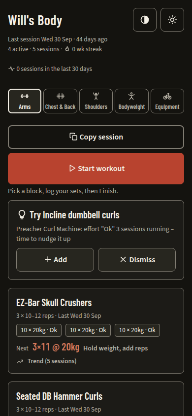 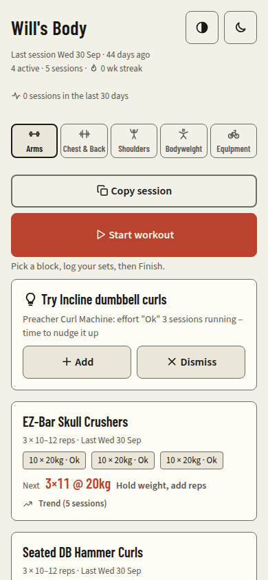</p>

The two theme photos above are the 1.19.0 matte home. Photos further down (timer, folded cards, discard, toasts) are from earlier releases and still show the old chrome.

## Features

### Floating rest timer pill
The rest timer starts automatically after every logged set (60–90 s, default 75 s) and ends with a vibration and a soft beep. **−15s / +15s** adjust only the running countdown (your saved default is untouched) and **Skip** stops it. The pin button switches between a floating pill and a full-width docked bar; the choice is remembered.

<p>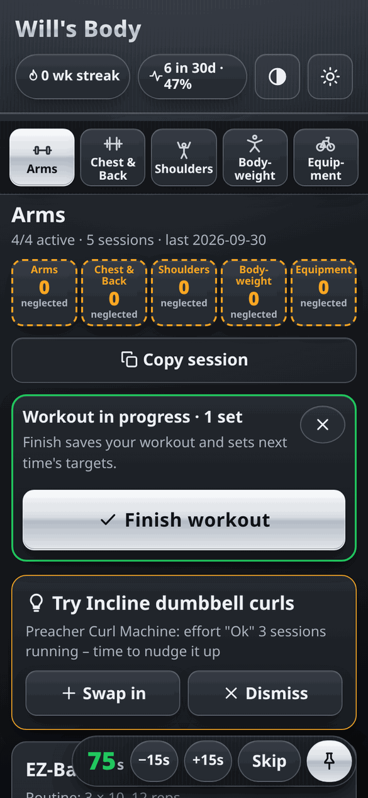 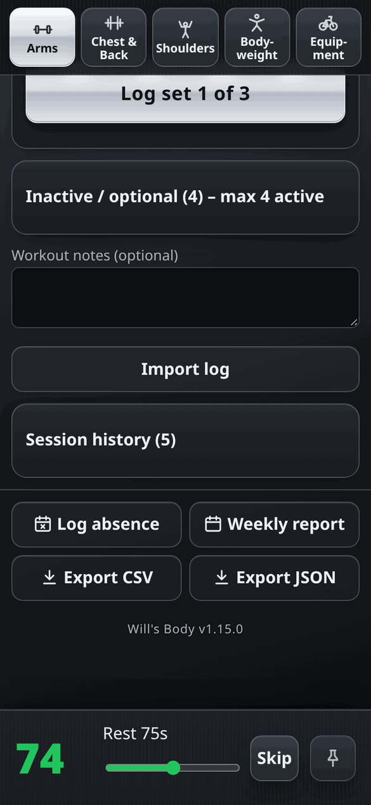</p>

### Finished exercises fold away
Once an exercise's target sets are logged, its card collapses to a single line (✓ name · 3/3 sets) so the next exercise is in view. Tap to reopen it.

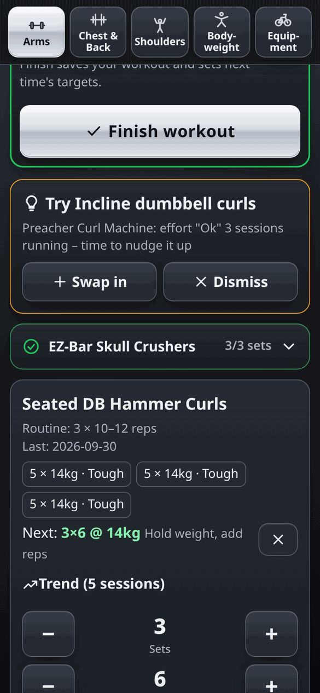

### Reduce shine
A header toggle switches to a flat high-contrast theme (black or white, thicker ink borders, the same rust primary) in either colour scheme. If you haven't chosen, it follows the system's *increase contrast* setting, and it applies before first paint so there's no flash.

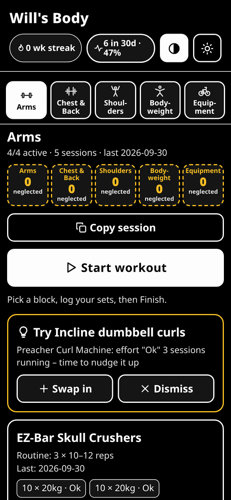

### Themed pop-up toasts
Short confirmations ("Workout saved – next targets set", "Session copied"…) appear near the top in the app's own style, clear of the controls and timer. They're announced to screen readers through an `aria-live` region and fade out on their own.

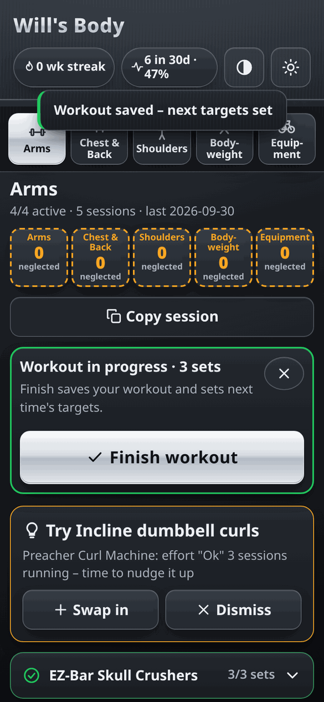

### Cancel a workout by accident
The *Workout in progress* banner has an **X** button. It asks *"Discard this workout? Sets logged in this session won't be saved."*. **Keep going** closes the prompt; **Discard** clears the unsaved sets and notes, stops the timer and returns to the home screen. Saved history is never touched.

<p>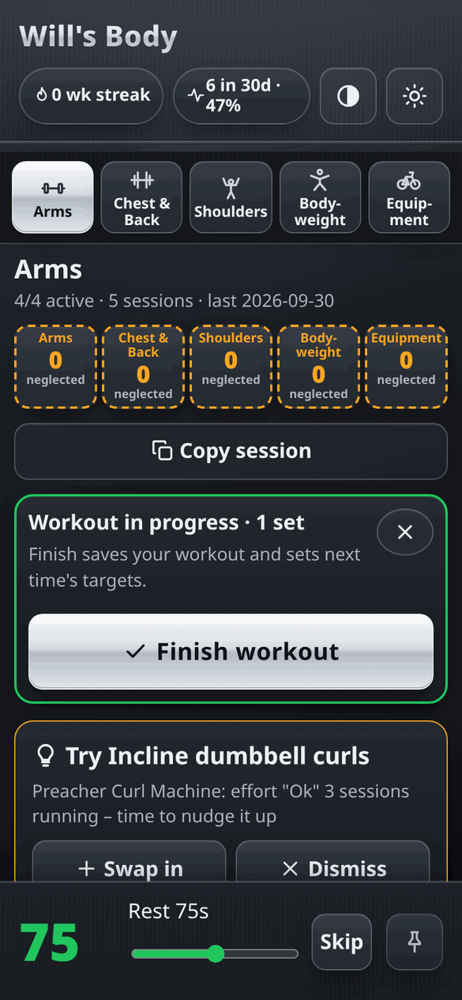 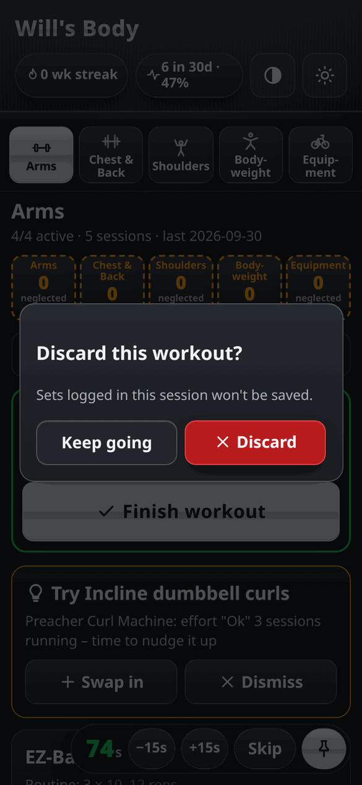</p>

### Matte dark theme and light theme
Dark by default: graphite and chalk, with one plate-rust primary (`#B8432F`) and chalk type on that fill in every theme, including light and Reduce shine. Cards are flat colour plus a 1px edge — no metal, glass, or glow. The light theme is one tap away in the header and is remembered; the browser theme colour follows the page background. Display type is self-hosted Barlow Condensed; body type is self-hosted Source Sans 3 (see `fonts/OFL.txt`).

### Line-icon set
One consistent set of inline SVG stroke icons (24×24, `currentColor`) replaces emoji across tabs, buttons and cards, so icons follow the theme and stay crisp at any size.

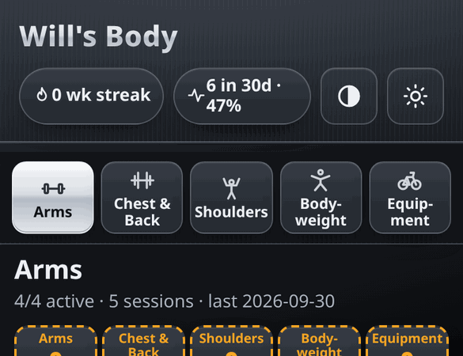

### Training logic and history
- **Five tabs:** Arms, Chest & Back, Shoulders, Bodyweight, Equipment. **No cap** on how many exercises are active — add or deactivate freely per session. Rowing machine and Treadmill log **metres + minutes**; StepMaster and Bike stay Level + min.
- **Typed steppers:** tap − / + or type reps, distance, and weight directly (mobile-friendly `inputmode`; − no longer triggers pinch-to-zoom).
- **Combined Rowing card** on Bodyweight: one entry for distance (m) and time (min). Older time/distance logs still show under that card. Equipment Rowing machine / Treadmill use the same dual fields.
- **Exercise library:** per-tab "Exercise library" card to add custom exercises (name, unit, targets) and pull from built-in suggestions; stored offline in `localStorage`.
- **Next-session plan** per exercise from its history: all target reps hit → +2.5 kg (or +1 rep/unit); a Tough set → repeat; two misses in a row → 5% deload.
- **Plateau and stall detection** with suggestion cards (swap in a same-muscle alternative from an approved library, or dismiss).
- **Deload reminder** after 6 training weeks, with a pre-filled −20% session (snooze or skip a cycle).
- **Start workout sheet:** logs several blocks in one go, pre-filled from the plan, with *Last time* one-tap fill and an optional date.
- **Personal records** (top weight, best reps, best weight × reps) shown on a record card. There is no confetti.
- **Session history** with optional notes, **trend sparklines** and an estimated 1RM (Brzycki).
- **Weekly streak** (work/holiday absences don't break it), a **this-week strip** of session counts per tab, workouts in the last 7/30/90 days, and a **weekly report** with human dates (`9–15 Nov`).

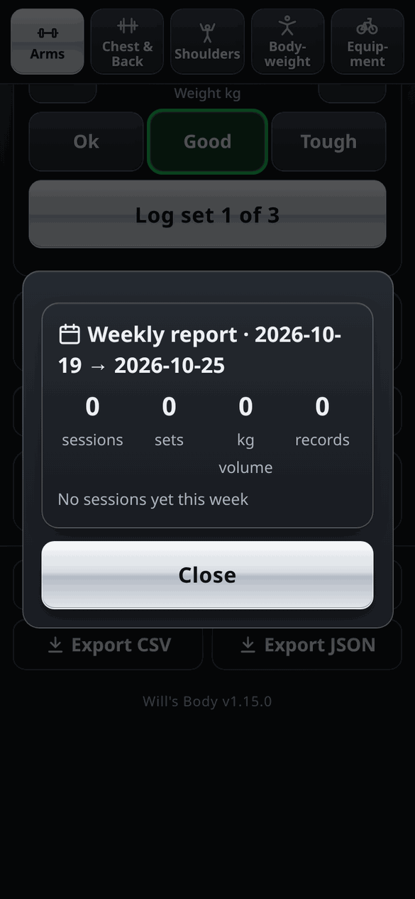

### Data, offline and install
- **Offline-first PWA:** a service worker caches the app shell under a versioned cache; it installs to the home screen on iOS and Android.
- **Private by default:** all data lives in the browser's `localStorage`; nothing is sent anywhere.
- **Workout in progress survives a reload:** logged sets and notes are saved as you go and restored the same day if the app is closed, killed by iOS, or reloaded.
- **Failure-safe storage:** a failed save shows a toast instead of failing silently; unreadable or unknown-version data is kept in a `willsBody.v1.corrupt-…` / `.pre-migrate-…` copy before anything else happens, and if that can't be done the app shows a rescue card with a raw export instead of loading sample data. The app asks the browser for persistent storage.
- **Backup and restore:** *Export JSON* is a full backup; importing it restores everything after a confirm (the previous data is kept in `willsBody.v1.pre-restore`). Tab imports (JSON or CSV) are validated session by session and can be undone once (toast **Undo** or *Undo last import* in the import dialog). **Export CSV** and **copy session** as plain text.
- **Accessible:** labelled controls, `aria-pressed`/`aria-expanded` states, focus is kept on folding cards, and reduced motion is respected.

## Tech stack
- **HTML5, CSS3 (custom properties, `dialog`), vanilla ES2020 JavaScript:** no frameworks or dependencies.
- **`rules.js`:** pure, DOM-free training logic (progression, plateaus, records, reports, CSV), shared by the app and the tests.
- **`app.js`:** UI rendering, event delegation, timer, dialogs, preferences.
- **Service worker (`sw.js`)** + **Web App Manifest** for offline use and installability.
- **Web APIs:** `localStorage`, Clipboard, Vibration, Web Audio, `matchMedia` (contrast / reduced motion).
- **Tests:** Node's built-in `assert` (`rules.test.js`), with no test framework.
- **Hosting:** GitHub Pages from `main`.

## Run locally
```bash
git clone https://github.com/Stocks84/wills-body.git
cd wills-body
python3 -m http.server 8000   # or: npx serve .
# open http://localhost:8000
```
A local server is needed for the service worker and the `data/*.json` fetches.

**Tests** (Node 18+):
```bash
node rules.test.js
```

## Versioning
The version lives in `manifest.webmanifest` and is shown in the app footer. Its middle number must match the `wills-body-vN` cache name in `sw.js` (a test enforces this), so each release refreshes the offline cache.

**1.19.0** — Matte visual pass: graphite / chalk / plate-rust tokens, self-hosted fonts, compact home cards, Strong-style logging rows, docked rest timer with a safe-area inset, sticky Finish on the start-workout sheet, human `en-GB` dates, and no confetti. Reduce shine stays high-contrast without recolouring the primary button.

**1.18.0** — data safety: in-progress workouts persist across reloads; save errors are reported; corrupt or unknown-version data is backed up, migrated or rescued, never wiped; Export JSON is now a restorable full backup; imports are validated and sanitised (no script injection), undoable once, and CSV import is quote-aware and respects the `tab` column. Quick wins: 16px fields (no iOS zoom), 48px ✕/fold buttons, Undo after deactivating an exercise, readable week-strip text on filled cells, `aria-pressed` on effort/block buttons, and a confirm before closing a Start-workout sheet with entries.

**1.17.0** — Equipment Rowing machine and Treadmill log distance (m) + time (min); StepMaster/Bike stay Level + min. Older level-based logs keep their minutes (metres show as 0).

**1.16.0** — typed steppers (no pinch-zoom on −), unlimited active exercises, combined Bodyweight Rowing (distance + time), and a per-tab exercise library. Screenshots for these UI bits not re-captured this release; existing gallery still shows timer/fold/theme.

<details><summary>Import format</summary>

JSON (one tab):
```json
{
  "routine": [{"id":"ex-curl","name":"Dumbbell curl","targetSets":3,"targetReps":10,"unit":"kg"}],
  "sessions": [{"date":"2026-10-01","entries":[{"exerciseId":"ex-curl","sets":[{"reps":10,"weight":12,"effort":"Good"}]}]}]
}
```
`unit`: `kg` | `bodyweight` | `m` | `min` | `level` | `rowing` (distance m + time min). `effort`: `Ok` | `Good` | `Tough`. CSV: `date,exercise,set,reps,weight,effort[,tab,unit,notes]` (header optional; with a header, columns are matched by name; quoted fields with commas, quotes and line breaks are fine). Rows whose `tab` is another tab are skipped, so the app's own Export CSV can be imported tab by tab. A tab import replaces that tab's sessions (exercises are matched by name, new ones are added) and can be undone once. Invalid sessions are rejected with a message; numbers and efforts are sanitised.

Full backup: the file from **Export JSON** (`{"version":2,"tabs":{…}}`) restores every tab and setting after a confirm.
</details>

---
*This README is kept in sync with each version release: the feature list and screenshots are refreshed whenever a new version ships.*
