# Will's Body

A mobile-first, offline-capable gym logging app (Progressive Web App) built with plain HTML, CSS and JavaScript: no framework, no build step, no backend. It plans each exercise's next session from your history, keeps the rest timer in reach, and stores everything privately on the device.

**Live app:** https://stocks84.github.io/wills-body

<p>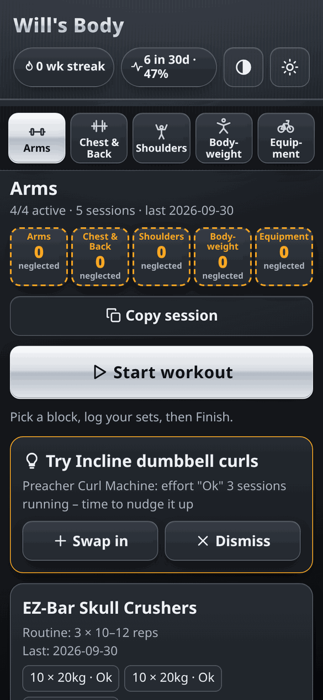 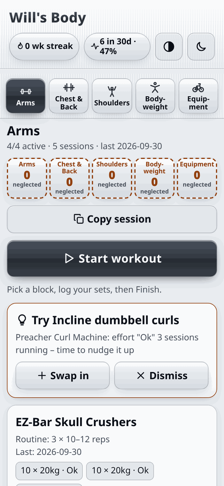</p>

## Features

### Floating rest timer pill
The rest timer starts automatically after every logged set (60–90 s, default 75 s) and ends with a vibration and a soft beep. **−15s / +15s** adjust only the running countdown (your saved default is untouched) and **Skip** stops it. The pin button switches between a floating pill and a full-width docked bar; the choice is remembered.

<p>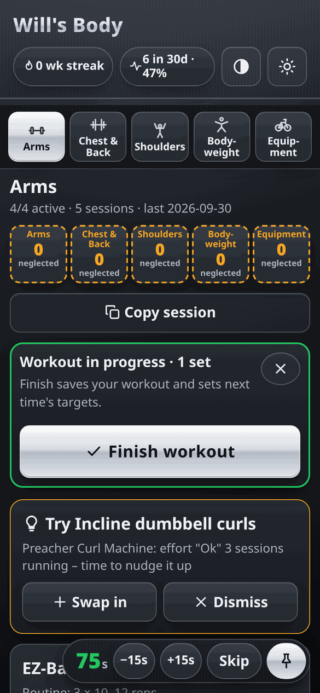 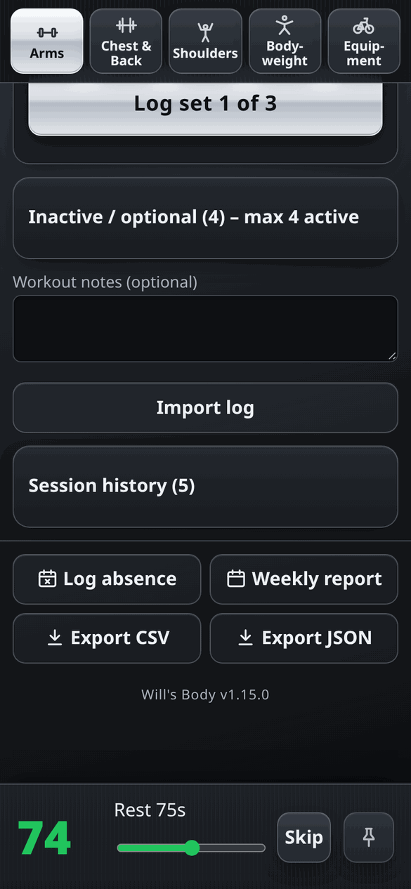</p>

### Finished exercises fold away
Once an exercise's target sets are logged, its card collapses to a single line (✓ name · 3/3 sets) so the next exercise is in view. Tap to reopen it.

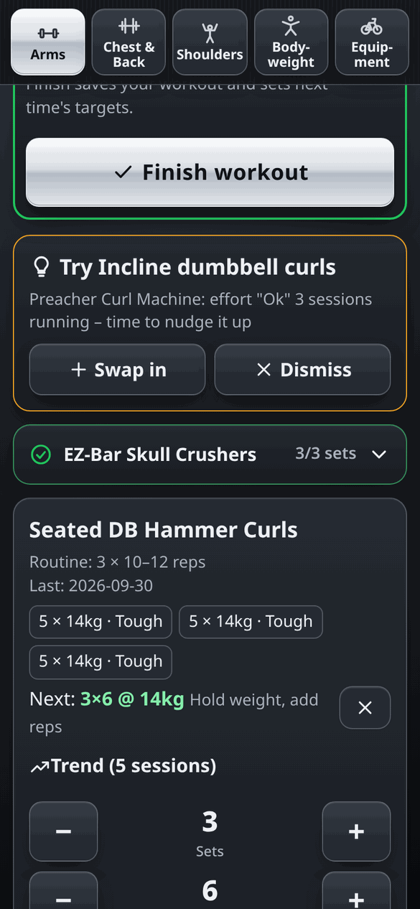

### Reduce shine
A header toggle replaces the metallic gradients with flat, high-contrast colours, in both themes. If you haven't chosen, it follows the system's *increase contrast* setting, and it applies before first paint so there's no flash.

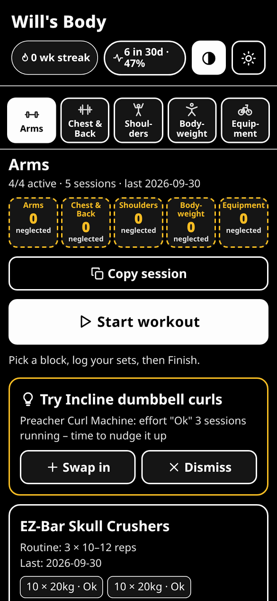

### Themed pop-up toasts
Short confirmations ("Workout saved – next targets set", "Session copied"…) appear near the top in the app's own style, clear of the controls and timer. They're announced to screen readers through an `aria-live` region and fade out on their own.

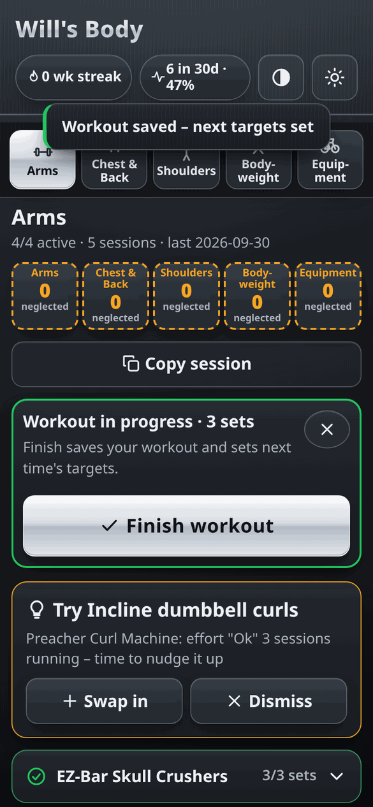

### Cancel a workout by accident
The *Workout in progress* banner has an **X** button. It asks *"Discard this workout? Sets logged in this session won't be saved."*. **Keep going** closes the prompt; **Discard** clears the unsaved sets and notes, stops the timer and returns to the home screen. Saved history is never touched.

<p>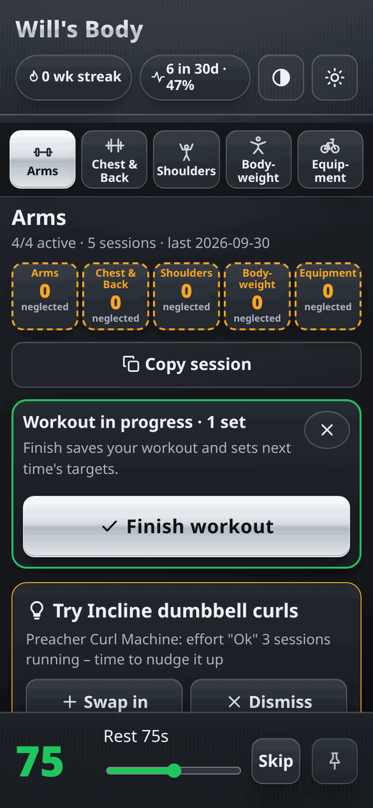 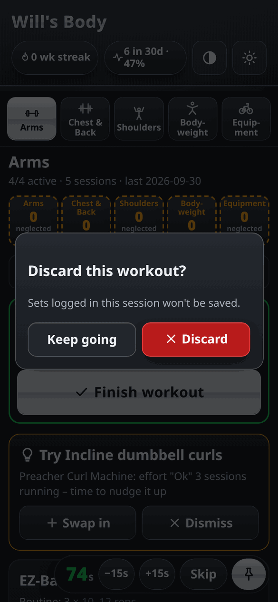</p>

### Metallic dark theme and light theme
Dark by default, with brushed-metal gradients, rim highlights and chrome primary buttons. The light theme is one tap away in the header and is remembered; the browser theme colour follows it.

### Line-icon set
One consistent set of inline SVG stroke icons (24×24, `currentColor`) replaces emoji across tabs, buttons and cards, so icons follow the theme and stay crisp at any size.

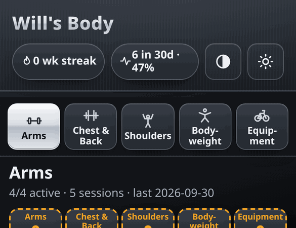

### Training logic and history
- **Five tabs:** Arms, Chest & Back, Shoulders, Bodyweight, Equipment (cardio machines by level and minutes). **No cap** on how many exercises are active — add or deactivate freely per session.
- **Typed steppers:** tap − / + or type reps, distance, and weight directly (mobile-friendly `inputmode`; − no longer triggers pinch-to-zoom).
- **Combined Rowing card** on Bodyweight: one entry for distance (m) and time (min). Older time/distance logs still show under that card.
- **Exercise library:** per-tab "Exercise library" card to add custom exercises (name, unit, targets) and pull from built-in suggestions; stored offline in `localStorage`.
- **Next-session plan** per exercise from its history: all target reps hit → +2.5 kg (or +1 rep/unit); a Tough set → repeat; two misses in a row → 5% deload.
- **Plateau and stall detection** with suggestion cards (swap in a same-muscle alternative from an approved library, or dismiss).
- **Deload reminder** after 6 training weeks, with a pre-filled −20% session (snooze or skip a cycle).
- **Start workout sheet:** logs several blocks in one go, pre-filled from the plan, with *Last time* one-tap fill and an optional date.
- **Personal records** (top weight, best reps, best weight × reps) with a confetti banner (none under `prefers-reduced-motion`).
- **Session history** with optional notes, **trend sparklines** and an estimated 1RM (Brzycki).
- **Weekly streak** (work/holiday absences don't break it), **this-week strip** that highlights neglected tabs, workouts-vs-plan percentage, and a **weekly report**.

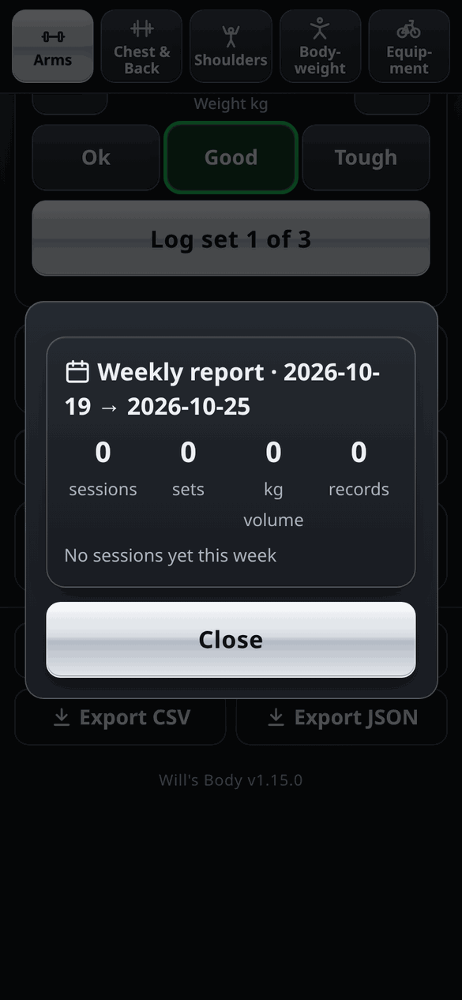

### Data, offline and install
- **Offline-first PWA:** a service worker caches the app shell under a versioned cache; it installs to the home screen on iOS and Android.
- **Private by default:** all data lives in the browser's `localStorage`; nothing is sent anywhere.
- **Import** JSON or CSV per tab; **export** JSON backup or CSV; **copy session** as plain text.
- **Accessible:** labelled controls, `aria-pressed`/`aria-expanded` states, focus is kept on folding cards, and reduced motion is respected.

## Tech stack
- **HTML5, CSS3 (custom properties, `dialog`), vanilla ES2020 JavaScript:** no frameworks or dependencies.
- **`rules.js`:** pure, DOM-free training logic (progression, plateaus, records, reports, CSV), shared by the app and the tests.
- **`app.js`:** UI rendering, event delegation, timer, dialogs, preferences.
- **Service worker (`sw.js`)** + **Web App Manifest** for offline use and installability.
- **Web APIs:** `localStorage`, Clipboard, Vibration, Web Audio, `matchMedia` (contrast / reduced motion).
- **Tests:** Node's built-in `assert` (`rules.test.js`), with no test framework.
- **Hosting:** GitHub Pages from `main`.

## Run locally
```bash
git clone https://github.com/Stocks84/wills-body.git
cd wills-body
python3 -m http.server 8000   # or: npx serve .
# open http://localhost:8000
```
A local server is needed for the service worker and the `data/*.json` fetches.

**Tests** (Node 18+):
```bash
node rules.test.js
```

## Versioning
The version lives in `manifest.webmanifest` and is shown in the app footer. Its middle number must match the `wills-body-vN` cache name in `sw.js` (a test enforces this), so each release refreshes the offline cache.

**1.16.0** — typed steppers (no pinch-zoom on −), unlimited active exercises, combined Bodyweight Rowing (distance + time), and a per-tab exercise library. Screenshots for these UI bits not re-captured this release; existing gallery still shows timer/fold/theme.

<details><summary>Import format</summary>

JSON (one tab):
```json
{
  "routine": [{"id":"ex-curl","name":"Dumbbell curl","targetSets":3,"targetReps":10,"unit":"kg"}],
  "sessions": [{"date":"2026-10-01","entries":[{"exerciseId":"ex-curl","sets":[{"reps":10,"weight":12,"effort":"Good"}]}]}]
}
```
`unit`: `kg` | `bodyweight` | `m` | `min` | `level`. `effort`: `Ok` | `Good` | `Tough`. CSV: `date,exercise,set,reps,weight,effort` (header optional). Importing replaces that tab's sessions.
</details>

---
*This README is kept in sync with each version release: the feature list and screenshots are refreshed whenever a new version ships.*
